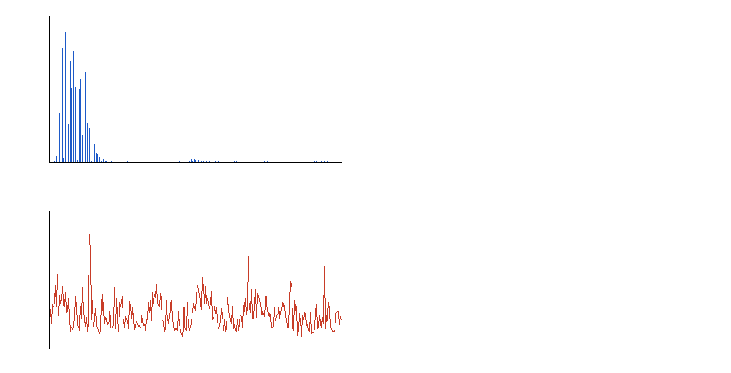

# X4F103-linux

Getting raw radar measurements out of a **Novelda X4F103** dev kit on Linux,
where Novelda HPD Studio 2.4.9 fails with
*"An error happened while verifying the firmware"* (`0xf5`) and then
*"An error happened in a call to a chipinterface function"* (`0xf4`).

Verified working: **19.8 Hz frame rate, 192 int16 samples per frame, 385-byte
payload**, captured directly over FT4222 SPI with no HPD involvement.

## Results (measured, not projected)

| Quantity | Value | How |
|---|---|---|
| Frame rate | **19.78 Hz** (300 cycles / 15.17 s, avg 50.56 ms) | `replay` timing log |
| Frame payload | 385 B = 1 status byte + **192 int16** | USB capture + replay |
| Frames valid | 298/298 non-zero | `scripts/analyze.py` |
| Firmware verify | `00 e1 09 7d` | replay log |
| Frame energy | 3077 RMS, ±2 between frames | static scene |
| Strongest sample bin | bin 11, mean \|amp\| 15 503 | static scene |
| Motion metric (static) | median 6.9, p95 13.2 | mean \|frame-to-frame Δ\| |

Distance in metres is **not** established — bin length for this configuration is
unmeasured, so this repo reports bin indices only.



## Why HPD Studio fails on Linux

Two independent defects, both in the shipped Linux stack:

1. **IRQ polarity is inverted.** `Ft4222GpioDriver::RunInterruptThread`
   (`libX4Sensor.so` @ `0x18e00`) polls GPIO port 3 and treats a **high** level
   as the interrupt (`0x18ebd`: `test eax,eax; jne <fire callbacks>`). The X4F103
   asserts its IRQ line **low**. The callback therefore never fires,
   `frameReady_` is never set, and every `chipinterface_wait_for_interrupt()`
   returns `0xFE` (condvar timeout) → `0xf4` → abort.
2. **The interrupt endpoint is not used.** Windows drives the same board through
   the FT4222 interrupt endpoint `0x83`, which delivers `02 00 0f 07` at 20 Hz.
   The Linux driver polls a GPIO input instead.

The 50 000 µs timeout in `upload_firmware_spi` is a red herring: raising it to
250 000 µs does not help.

## How this works

`src/replay.c` opens the FT4222 directly through `libft4222` and replays the
exact SPI write stream captured from a working Windows HPD session
(`data/seq.txt`, 1100 writes, including the 511 firmware chunks).

The critical detail is **timing**. Replaying the bytes as fast as possible
yields all-zero frames; replaying them on the recorded per-command schedule
yields valid frames:

- ~0.2 ms spacing between commands inside a cycle
- ~33 ms settle after the run-mode write `8f 0e 02 01`
- ~50 ms per frame cycle, locked so the host cannot drift off the die's cadence

## Build and run

Requires `libft4222.so` (from HPD Studio or the FTDI SDK) and the FT4222H
connected as interface A.

```bash
make
sudo ./replay data/seq.txt 300      # 300 frames ≈ 15 s
```

Output: per-run summary, `frames.bin` (385 B per frame), and the rate log.

Environment knobs (all optional):

| Var | Meaning |
|---|---|
| `REPLAY_TIMING=1` | honour the recorded schedule — **required for valid frames** |
| `CYCLE_US=50000` | frame cadence target |
| `ST_DELAY_US=0` | extra delay per steady-state transfer (0 on top of the schedule) |
| `RD_TRIES`, `RD_DELAY_US` | retry policy for the initialisation reads |

## Analysing frames

```bash
python3 scripts/analyze.py frames.bin
```

Prints frame count, zero-frame count, per-frame energy, the per-bin amplitude
profile, and the frame-to-frame motion metric.

## Protocol notes

See [docs/PROTOCOL.md](docs/PROTOCOL.md) for the full init/upload/verify/start
sequence, opcode meanings, error codes, and the command cycle.

## Open items

- **GPIO port 3 stays low for the whole run**, even while frames stream at
  19.8 Hz. The frame interrupt is not on that pin on this board — use the FT4222
  interrupt endpoint (`0x83`) if an interrupt path is needed.
- **No distance calibration** — bin length unknown.
- Firmware upload relies on replayed bytes rather than a parsed `.hpd` package.

## Hardware / software

- Novelda X4F103 development kit, FT4222H USB-SPI bridge (`0403:601c`)
- Host: Debian, kernel 6.8, x86-64, `libft4222.so` from HPD Studio 2.4.9
- Reference capture: Windows 10, HPD Studio 2.4.9, USBPcap
